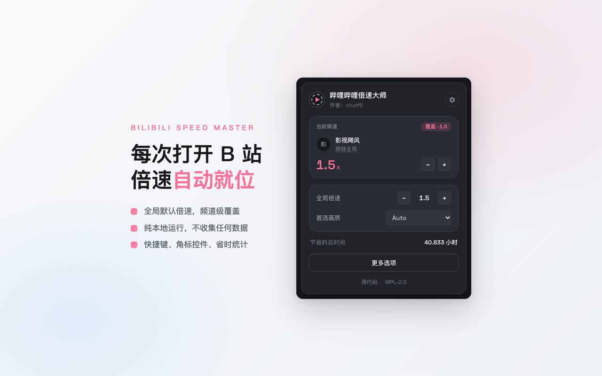
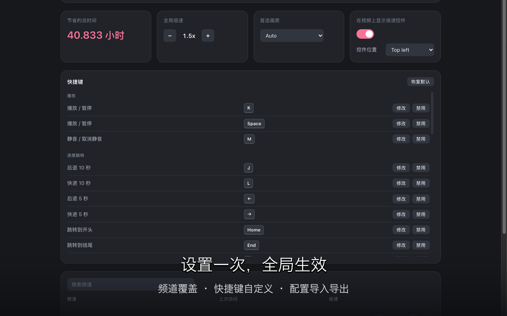
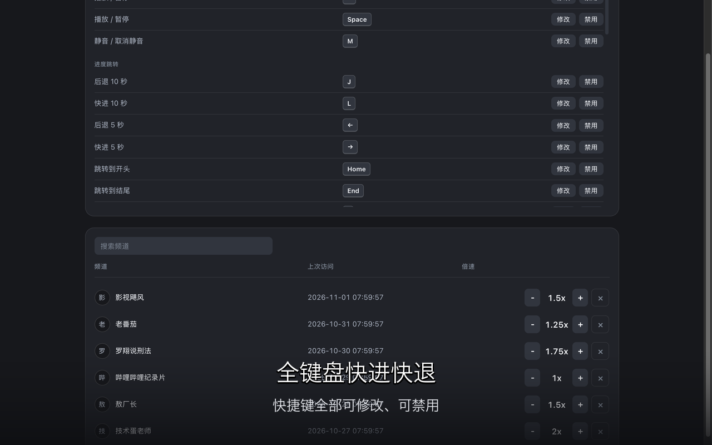

<p align="center">
  
</p>

<h1 align="center">哔哩哔哩倍速大师</h1>

<p align="center">
  <a href="README.md">简体中文</a> | <a href="docs/readme/README_EN.md">English</a>
</p>

<p align="center">
  调一次,B 站永远记住你每个频道的倍速。
</p>

<p align="center">
  <a href="https://github.com/cholf5/bilibili-speed-master/releases/latest"></a>
  
</p>

> **状态**:v0.1.0 · [GitHub Release 已发布](https://github.com/cholf5/bilibili-speed-master/releases/latest)。

B 站自带的倍速菜单不记偏好,每个视频都要重调一次,上限也只有 2 倍。这个扩展给它补上记忆:设一个全局默认倍速,常看的频道再单独覆盖,之后打开任何视频,自动就是你要的速度。0.1–4 倍,按 0.1 步进,所有设置只存在你本地。

<p align="center">
  
</p>

## 功能

- **全局默认倍速**:没有单独设置的频道,自动用全局速度。
- **频道覆盖**:在某个频道任意视频里调一次,之后这个频道都按这个速度播。改回全局值也算一次设置,不会被当成没调过。
- **播放器角标**:视频左上角一个小控件,点加减直接调速,手动调过的值自动记入该频道的偏好。
- **键盘调速**:`>` 加速、`<` 减速,快进快退播放暂停用 J/K/L 那套;快捷键全部可以改,也可以禁用。
- **省时统计**:累计倍速播放省下的时间,总账在 popup 里。

## 截图

<p align="center">
  
</p>

<p align="center">
  
</p>

<p align="center">
  
</p>

## 安装

这个扩展没有上架 Chrome Web Store 或 AMO——上架要交开发者注册费,暂时没有这个计划。想用的话,从 [GitHub Release](https://github.com/cholf5/bilibili-speed-master/releases/latest) 手动安装:

1. 在最新 Release 中下载对应浏览器的 zip(`chrome` 或 `firefox`)并解压。
2. **Chrome**:打开 `chrome://extensions` → 开启右上角"开发者模式" → "加载已解压的扩展程序" → 选择解压出的文件夹。
3. **Firefox**:打开 `about:debugging` → "此 Firefox" → "临时载入附加组件" → 选择解压出的 `manifest.json`。

> Firefox 临时载入在重启浏览器后会失效,重启后需要重新载入一次。

## 安全与隐私

- 所有数据只存在浏览器本地,没有服务器,也不需要登录。
- 只申请 `storage` 权限,不上报任何观看数据。
- 不动 B 站的推荐和播放策略。

## 开源与贡献

Bilibili Speed Master 是开源项目,欢迎提交 issue 或 PR。

- **开源内容**:核心逻辑、DOM 适配、行为拦截、配置存储
- **保留内容**:商店素材(Logo / Banner)、品牌名、官方发布渠道
- **Fork 与二次打包**:不得以相同名称在插件商店上架;商店素材与品牌名不受 MPL-2.0 约束
- **License**:MPL-2.0,允许商用、修改和分发,改动过的文件需保持开源。[详细条款](https://www.mozilla.org/en-US/MPL/2.0/)

## 开发与构建

需要 Node.js 与 pnpm(项目在 Node 25 上开发与构建)。

```bash
pnpm install       # 安装依赖
pnpm dev           # 开发模式(热更新)
pnpm dev:firefox   # Firefox 开发模式
pnpm build         # 生产构建
pnpm build:firefox # Firefox 生产构建
pnpm zip           # 打包为 Release ZIP
pnpm test          # 运行 Vitest 单元测试
pnpm compile       # 仅类型检查(无产物)
```

更多产品与 UI 说明请参考:[docs/spec.md](docs/spec.md)、[docs/popup.md](docs/popup.md)、[docs/options.md](docs/options.md)
